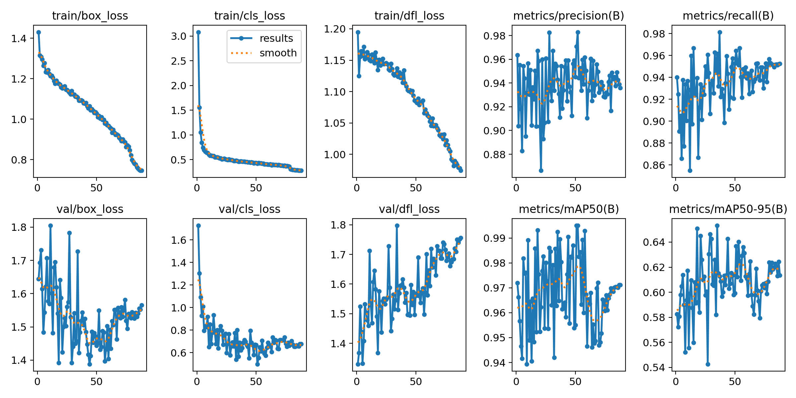
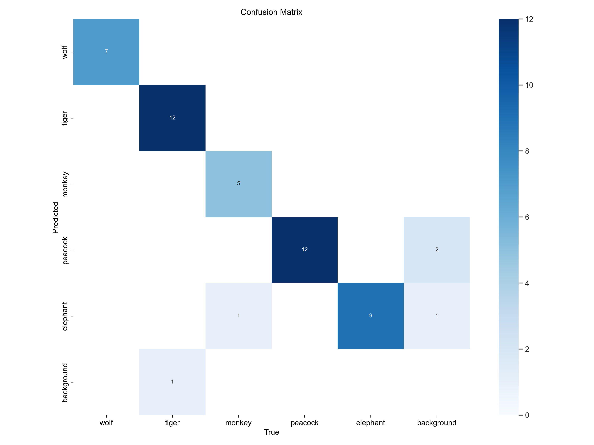

# D435 + YOLOv8 野生动物识别与平面定位

## UAV Wildlife Detection and Localization

I built the vision module for a student UAV competition. It detects five
animal classes in images from an Intel RealSense D435, counts detections
in a central survey area, and publishes the results over ROS.

I collected and labeled training images, trained the YOLOv8 detector, and
integrated it with the camera and ROS. To estimate each detection's offset
from the image center in centimeters, I used the camera intrinsics and a
known flight height. A five-frame vote stabilizes the animal counts.

电赛野生动物巡查项目的视觉部分：用 Intel RealSense D435 获取彩色图像，使用本地训练的 YOLOv8 检测五类动物，在中央区域统计数量，以相机内参和固定高度估计平面偏移，通过 ROS 发布结果。

**个人负责：数据采集与标注、YOLOv8 训练、D435 定位及 ROS 通信。** 无人机飞控、航线规划和地面站不在本仓库实现范围内。

本仓库由保存的比赛材料整理而成。定位方式已确认是固定高度换算，主程序没有读取深度图。代码是整理后的展示版本，不是逐字复原的赛场快照；修改范围见 [来源与变更](docs/provenance.md)。

## 处理流程

```text
D435 彩色图像 + 同分辨率内参
          ↓
YOLOv8 检测框、类别、置信度
          ↓
中央 50 cm × 50 cm ROI 筛选
          ↓
给定高度 → 像素偏移换算为厘米
          ↓
5 帧数量投票 + 按类别平均偏移
          ↓
ROS String(JSON) 发布 / 订阅展示
```

该偏移以图像中心为原点、向右和向下为正，依赖相机近似垂直地面、地面近似平坦和高度已知。不是地理坐标、飞控坐标或动态三维测距；不包含逐目标跟踪与跨方格去重。

## 目录

| 路径 | 内容 |
|---|---|
| `training/train.py` | YOLOv8n 训练入口 |
| `config/data.example.yaml` | 五类数据配置模板 |
| `tools/` | D435 采集、内参读取、合成数据与标签检查 |
| `inference/` | D435 识别及 ROS 发布、订阅 |
| `models/best.pt` | 按比赛使用版本整理的 train13 模型权重 |
| `reports/train13/` | 88 轮历史训练日志、曲线、混淆矩阵 |
| `docs/` | 运行说明、消息协议、问题复盘、证据边界 |
| `tests/` | 不需要相机的逻辑回归检查 |

## 模型与训练证据

仓库按项目作者回忆的比赛使用版本，附带 train13 的 `best.pt` 权重，来自本地 `runs/detect/train13/weights/best.pt`，配套保存训练配置、日志与评估曲线。权重字节保持不变；SHA-256 见 [校验文件](models/SHA256SUMS)。

checkpoint 中的类别顺序为 `wolf, tiger, monkey, peacock, elephant`，版本元数据为 Ultralytics 8.2.103；训练记录为 YOLOv8n、88 epochs、imgsz 960、batch 16。best.pt 保存的历史验证指标对应第35轮：mAP50 为 0.99254、mAP50-95 为 0.65320；第88轮日志分别为 0.97116 和 0.61344。最佳权重与最后一轮结果分开记录，这些都不是赛场实测准确率或本次重新评估结果。





## 开始使用

完整步骤见 [运行说明](docs/deployment.md)。具备 D435、ROS 1 及依赖环境后，从仓库根目录运行：

```bash
python inference/ros_publisher.py --weights models/best.pt --height-cm 120
python inference/ros_subscriber.py
```

两个程序分别在两个终端运行，ROS master 需已启动。默认发布话题为 `/animal_detections`，使用整理版 JSON 协议，不能直接替换旧 `/animal_result` 字符串接口。运行频率随模型推理耗时变化，30 FPS 相机配置不等于端到端处理达到 30 FPS。

## 数据与验证边界

不附带整套训练图片、原始聊天记录、比赛报告、第三方框架源码和飞控代码。合成脚本需要自备有权使用的背景与透明前景图，合成时必须保持标签顺序一致。

当前磁盘数据检查发现训练集 3929 张、验证集 72 张图片，其中分别有 167 张和 19 张没有同名标签。这些可能是背景图，也可能是漏标，尚未逐张确认；不能据此认为数据已完全清理。按原始照片、视频或合成素材分组后再划分训练验证集，避免相近素材泄漏。

整理阶段验证 Python 语法、关键逻辑、文件校验和数据标签格式。未在 D435/ROS 实机环境执行、未重新训练或加载模型推理；历史结果与整理后代码的实测表现分开看待。

第三方组件与模型说明见 [THIRD_PARTY.md](THIRD_PARTY.md)。
